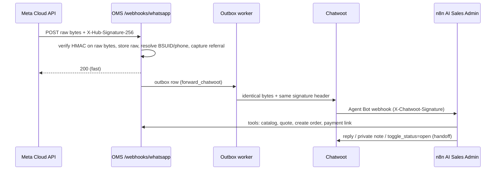

# 03 — System Architecture (multi-portfolio, multi-platform)

## Layers

```mermaid
flowchart TB
    A["Central Ecommerce Portfolio Manager<br/>(Next.js + Refine dashboard)"]
    A --> B["Portfolio A — FMCG"]
    A --> C["Portfolio B — Product category"]
    A --> D["Portfolio N — Experiments"]
    B & C & D --> E["Platform Account Registry<br/>(advertising · sales · messaging · procurement · shipping · payments)"]
    E --> F["Meta Ads / WhatsApp"]
    E --> G["Shopee / Tokopedia & Shop"]
    E --> H["TikTok Shop / Lazada"]
    E --> I["Google Ads / Organic"]
    F & G & H & I --> J["Unified OMS (FastAPI + PostgreSQL)"]
    J --> K{"Fulfillment Router"}
    K --> L["Owned stock — Biteship"]
    K --> M["Dropship — Procurement copilot (human)"]
    K --> PM["Platform-managed (marketplace native)"]
    L & M & PM --> N["Settlement & Double-entry Ledger"]
    O["Ad spend + attribution"] --> P["Portfolio FP&A"]
    N --> P
    P --> Q["Capital allocation / risk controls<br/>(recommend-only + approvals)"]
    Q -.-> A
```

## Runtime components

| Component | Responsibility | Source of truth for |
|---|---|---|
| `oms-api` (FastAPI) | REST API, webhooks, RBAC, domain logic | Everything transactional |
| `oms-worker` | Outbox dispatcher (`FOR UPDATE SKIP LOCKED`), scheduled syncs | — |
| PostgreSQL 16 | Tenant-scoped data, RLS | Orders, customers, ledger, attribution |
| Chatwoot | Shared inbox, human handoff | Conversation UI only |
| n8n | AI Sales Admin, notifications, schedules | Nothing (stateless orchestration) |
| Metabase | Analytics on read-only views | — |
| Dashboard (Next.js + Refine) | Operations + approvals UI | — |

## WhatsApp / Chatwoot / n8n topology

> **Superseded by `06-design-revisions.md` R1.** The OMS is now the single WhatsApp gateway and Chatwoot uses an API-channel
> inbox, so nothing competes for Meta's callback. The original proxy design is kept below for the record only.

### (Superseded) proxy design — verified against Chatwoot v4.19.1 source

Chatwoot re-registers a phone-number-level webhook override on inbox creation and voice toggles; the OMS reasserts its own
override on a schedule and raises an integration-health alert on drift.

## Data flows

1. **Lead → order (WhatsApp)**: inbound message → identity + attribution touch → AI quote → order `placed` → `confirmed` →
   payment (DOKU link / manual transfer / COD) → router → fulfillment → delivered → ledger + conversion events.
2. **Marketplace native order**: adapter pull/push → `UNIQUE(platform_account_id, external_order_id)` upsert →
   `PLATFORM_MANAGED` fulfillment → settlement ingestion → reconciliation → ledger.
3. **Ad spend**: provider insights (daily, 28-day re-pull) → `daily_ad_insights` → campaign→portfolio allocations →
   FP&A (unallocated spend kept separately).
4. **Conversions**: order state change → `conversion_outbox` row (unique business key) → worker re-checks eligibility
   (event supported, consent, ≤7 days, identifiers) → send / suppress / expire → delivery log.

## Tenancy & security
- Every business row carries `organization_id`; portfolio-scoped rows carry `portfolio_id`.
- Postgres RLS policies use `current_setting('app.org_id')` set per transaction; the API also filters by portfolios the
  caller holds a role in (`role_assignments`). The application connects as a non-superuser role so RLS applies.
- Credentials: `account_credentials.ciphertext` (Fernet); never serialized in API responses or logs.
- Irreversible actions (paid shipment booking, refunds, capital moves, ad changes, marketplace purchases) require a
  `human_approvals` row naming the approver and the exact amount/target.

## Architecture decisions
- **ADR-001 Modular monolith**: one FastAPI app with module boundaries; split only when an operational need appears.
- **ADR-002 Sync SQLAlchemy 2 + psycopg 3**: simpler transaction/RLS handling; FastAPI runs sync endpoints in a thread pool.
- **ADR-003 Transactional outbox instead of a separate job queue** (`procrastinate`/Redis dropped): every side effect is
  written in the same transaction as the business change and delivered by a `SKIP LOCKED` dispatcher with retries.
- **ADR-004 Mock-first adapters**: each provider has `base.py` (Protocol), `mock.py`, `live.py`; live requires credentials
  + `live_enabled` flag on the platform account; irreversible calls also need an approval.
- **ADR-005 Human-operated procurement**: Shopee/Tokopedia ToS forbid bots; the OMS guides a human and enforces limits.
