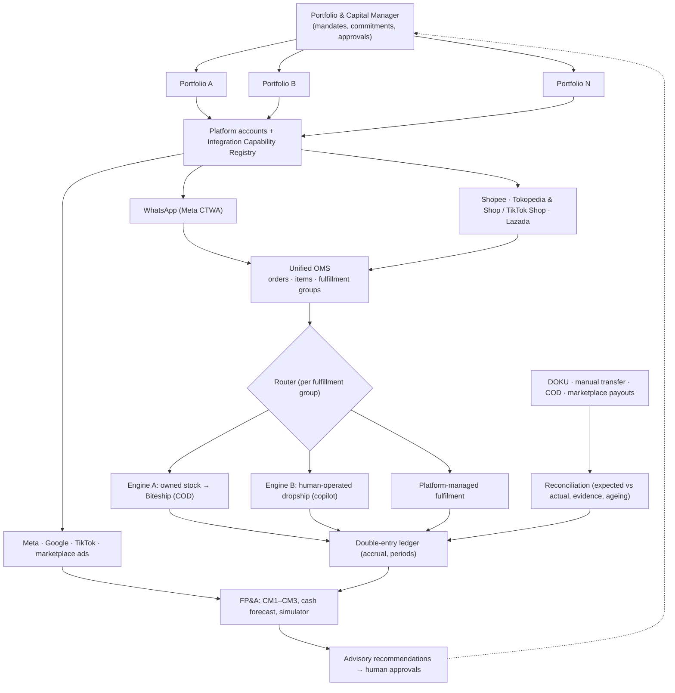

# 03 — Architecture Overview (V3.1)

> Source of truth: `docs/00-plan.md` §1–§4. Supersedes the V3.0 version of this file, including the Chatwoot
> WhatsApp-inbox proxy design (contradiction C1).

## Purpose
A modular-monolith operating system that lets one founder run several e-commerce portfolios from a constrained capital
pool, optimising **risk-adjusted contribution, capital productivity, cash conversion, reliability and liquidity**.

## Layers

## Runtime components (Sumopod)

| Component | Responsibility | Authoritative for |
|---|---|---|
| `oms-api` (FastAPI) | REST API, webhook receivers, commands, RBAC | — (stateless) |
| `oms-worker` (Procrastinate) | outbox relay, provider sync, CAPI, reconciliation, periodic jobs | — |
| PostgreSQL 16 | all business, financial, attribution data; RLS | **System of record** |
| Chatwoot (web + Sidekiq + Redis + object storage) | API-channel shared inbox, human handoff UI | Nothing financial |
| n8n | AI Sales Admin orchestration, notifications, schedules | Nothing (calls OMS commands) |
| Next.js + Refine dashboard | operations, approvals, finance UI | — |
| Metabase | read-only analytics on views | — |

## WhatsApp topology (single owner)
Meta → OMS webhook (persist raw event, commit, 200) → processing job → Chatwoot API-channel mirror → Agent Bot → n8n →
OMS policy-checked commands → OMS send → Meta. Human replies from Chatwoot reach Meta only through OMS send commands;
mirror echoes are suppressed. Details: `13-whatsapp-api-channel.md`.

## Cross-references
ERD `08-erd.md` · security `09-tenant-security-rls.md` · state machines `10-state-machines.md` · accounting
`11-accounting-policy.md` · reconciliation `12-…` · FP&A `14-…` · simulator `15-…` · AI `16-…` · exceptions `17-…` ·
ops `18-…` · ADRs `07-adr.md`.
