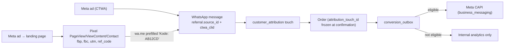

# 05 — Meta Ads, WhatsApp Attribution, Pixel & CAPI

## Acquisition funnel

## Capture rules
- Every inbound message with a `referral` object creates one `customer_attribution` row (`UNIQUE(inbound_message_id)`):
  `ad_id = referral.source_id` (only when `source_type = "ad"`), `ctwa_clid`, `source_url`, headline/body, raw JSON.
- `ad_id` is resolved to ad set/campaign/ad account and **validated against ad accounts owned by the organization**;
  unknown ad IDs are kept but flagged `unresolved`.
- Landing page path: `landing_sessions(ref_code, fbp, fbc, fbclid, gclid, utm_*)`; the first WhatsApp message containing
  `Kode: <ref>` links the session (`attribution_method = landing_ref_code`).
- No referral and no code → `attribution_method = unattributed`. Identifiers are never fabricated.
- The order's attribution is the latest touch within the lookback window (default 7 days) at confirmation time, frozen.

## Event policy (Business Messaging CAPI)

| OMS milestone | Meta event | When |
|---|---|---|
| First consented inbound message | `LeadSubmitted` | once per customer per business |
| AI/agent qualification | `QualifiedLead` | once per customer |
| Order confirmed | `OrderCreated` | once per order |
| Prepaid: payment verified + accepted | `Purchase` (value, IDR) | once per order |
| COD: delivered **and** collected | `Purchase` | once per order |
| Shipped / delivered | `OrderShipped` / `OrderDelivered` | per shipment (`occurrence_key` = shipment id) |
| Canceled / returned | `OrderCanceled` / `OrderReturned` | once; never retract a sent Purchase |

Send-time eligibility (re-evaluated by the worker, not at enqueue): event in the supported list ∧ (`ctwa_clid` present ∨
hashed fallback allowed) ∧ consent for purpose `meta_ad_measurement` ∧ `event_time` ≤ 7 days old. Otherwise the row
becomes `suppressed` (no consent / not supported) or `expired` (too old). Retries reuse the same `event_id`.

> V3.1 alignment: COD `Purchase` is sent at delivery, the same moment revenue is recognised (`11-accounting-policy.md`);
> COD remittance only clears the receivable and does not trigger or delay conversion events.

## Measurement separation
`meta_reported` (Insights `actions`) · `internally_attributed` (orders via frozen touch) · `financially_realized`
(delivered + collected/settled revenue). FP&A never treats Meta-reported conversions as sales.

## Privacy (UU PDP 27/2022)
- First AI reply includes a short notice + opt-in quick reply; stored as `consent_events` (append-only) and
  `privacy_preferences(customer_id, purpose)`.
- Withdrawal suppresses pending events immediately.
- Hashing: SHA-256 after normalization (phone digits with country code `62`, lowercase trimmed email).
