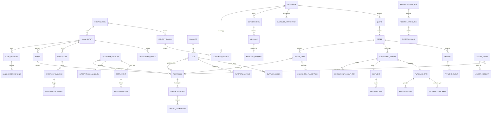

# 08 — Entity Relationship Model (V3.1)

> Source: `docs/00-plan.md` §5. Every tenant table carries `organization_id`; children reference parents with composite
> FKs `(organization_id, parent_id)`.

## Core ERD

## Key invariants (DB-enforced)

| Invariant | Mechanism |
|---|---|
| No cross-tenant references | composite FKs `(organization_id, id)` |
| Journals balance | deferred constraint trigger per `journal_id` |
| No oversell | `CHECK reserved <= on_hand` + row locks |
| No over-procurement | `CHECK qty_procured <= qty_allocated_dropship` on `order_items` + locked updates |
| Quantity pipeline | `CHECK` delivered ≤ shipped ≤ allocated ≤ ordered; returned ≤ delivered |
| External dedupe | `UNIQUE(account, external_order_id)`, `UNIQUE(provider, notification_id)`, `UNIQUE(account, wamid)`, `UNIQUE(marketplace_account, external_purchase_id)`, bank line fingerprint |
| Conversion dedupe | `UNIQUE(subject, event, destination, occurrence)` |
| Identity scope | `UNIQUE(identity_domain, provider, identity_type, value)` |
| Separation of duties | `CHECK decided_by <> requested_by` |
| Append-only history | UPDATE/DELETE revoked on events, journals, audit, movements |

Full table list with columns: `docs/00-plan.md` §5.
