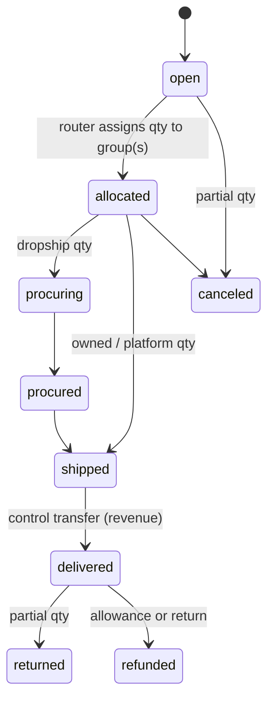
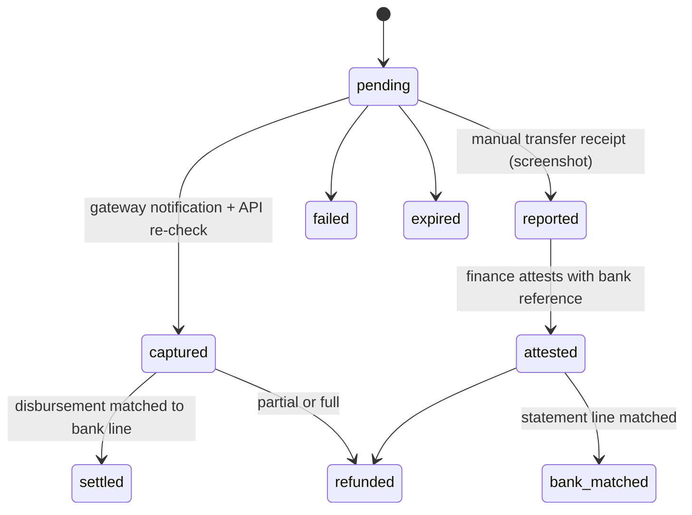

# 10 — Order, Fulfillment, Shipment, Payment, Settlement & Purchase State Machines

> Source: `docs/00-plan.md` §8 (ADR-010). Machines are independent; the order's aggregate status is **derived** from
> item, group, payment and case state and is never written directly.

## Order item (quantity-based)
Each stage is a quantity column with DB `CHECK`s: `qty_canceled + qty_allocated_* <= qty_ordered`,
`qty_procured <= qty_allocated_dropship`, `qty_shipped <= qty_allocated_owned + qty_procured + qty_platform`,
`qty_delivered <= qty_shipped`, `qty_returned <= qty_delivered`, `qty_refunded <= qty_ordered`.



## Fulfillment group
```mermaid
stateDiagram-v2
    [*] --> pending
    pending --> ready: prepaid captured/attested or COD approved
    ready --> reserved: OWNED_STOCK
    reserved --> packing --> packed --> booked: paid booking approved
    booked --> in_transit --> delivered
    in_transit --> failed
    failed --> returned
    ready --> purchase_pending: *_DROPSHIP
    purchase_pending --> awaiting_approval --> purchased --> supplier_shipped --> delivered
    supplier_shipped --> failed
    ready --> platform_fulfilling: PLATFORM_MANAGED
    platform_fulfilling --> in_transit
```

## Shipment
`draft → booked → picked → in_transit → delivered | on_hold | failed | returning → returned`. Carrier events are
idempotent on `(shipment, status, occurred_at)`; out-of-order events never move a shipment backwards (rank check).

## Payment

Release policy (configurable): fulfilment may start at `captured` or `attested`; reconciliation stays open until
`settled`/`bank_matched`; ageing beyond T+2 business days opens `bank_unmatched`.

## Settlement
`expected → received → matched | mismatch → resolved` (mismatch opens a case with exposure).

## Purchase task (human-operated dropship)
`open → observed → blocked | awaiting_approval → approved → purchased (lines, qty) → supplier_shipped → delivered |
canceled | supplier_canceled`. Concurrency: row lock on the task and order items; DB qty invariant rejects
over-procurement; `UNIQUE(marketplace_account, external_order_id)` rejects double-recording.

## Derived order status
| Derived status | Rule |
|---|---|
| `placed` | no payment, no allocation |
| `awaiting_payment` | prepaid and payment not captured/attested |
| `in_fulfillment` | any group between ready and in_transit |
| `partially_delivered` | some qty delivered, some outstanding |
| `delivered` | all non-canceled qty delivered |
| `partially_returned` | some delivered qty returned |
| `closed` | delivered/returned/refunded and all settlements matched |
| `canceled` | all qty canceled |
| `exception` | any open P0 exception case on the order |
