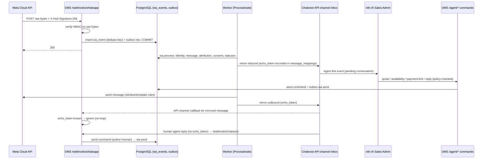

# 13 — WhatsApp Single-Owner Integration (Chatwoot API-Channel Inbox)

> Source: `docs/00-plan.md` §12, ADR-006. Supersedes the V3.0 proxy/reassert design (contradiction C1).

## Flow

## Requirements and design

| Concern | Design |
|---|---|
| Persist before ack | Signature check on raw bytes → `wa_events` insert + commit → 200; processing is async and replayable |
| Dedupe | `wa_events.dedupe_key` (sha256 of message/status ids); `UNIQUE(account, wamid)` on messages; idempotent status updates |
| Replay | Re-run `wa.process` for an event id; all effects idempotent |
| Retries | Outbox + Procrastinate with backoff and dead-letter review |
| Mapping | `message_mappings(message_id, wamid, chatwoot_message_id, echo_token, origin)` |
| Echo-loop prevention | Mirrors carry an `echo_token` (Chatwoot `source_id`/content attribute — **G-CW1** to verify field); callbacks matching a known token or originating from the OMS bot user are ignored |
| Status sync | sent/delivered/read/failed from Meta statuses → message status → mirrored to Chatwoot |
| Media | Inbound media downloaded via Graph media API into private object storage (retention policy); outbound uploads via `/media`; mirrored as Chatwoot attachments |
| Templates | `message_templates` registry with Meta approval status; required outside the 24-hour service window |
| Window | `conversations.window_expires_at` from last inbound; free text refused outside it |
| AI vs human | `messages.author` = customer/ai/human/system; AI replies go through the reply validator (`16-ai-authority-matrix.md`) |
| Handoff | conversation `ai_enabled=false`, Chatwoot `toggle_status=open`, private note with reason |
| Multi-WABA / numbers | Each phone number is a `platform_account`; routing by `metadata.phone_number_id` via a definer resolver |
| Ownership drift | Read-only check of Meta webhook config; critical integration alert; **never** auto-rewritten |
| n8n boundary | n8n holds no Meta credentials and no DB access; it calls OMS commands only |

## Status
V3.0 WIP code (`oms/app/modules/messaging.py`, `oms/app/integrations/{whatsapp,chatwoot,factory}.py`) is committed as
WIP and is reworked in M2 to match this design. Status: **Planned** (M2).
